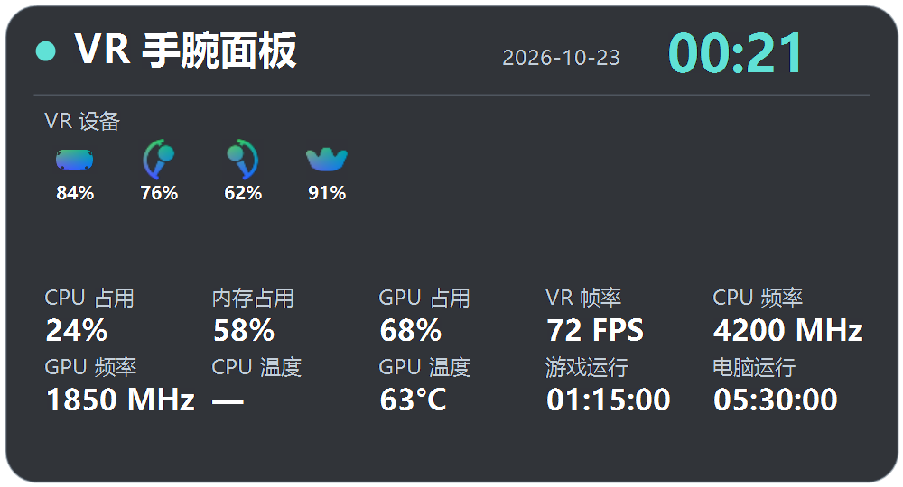
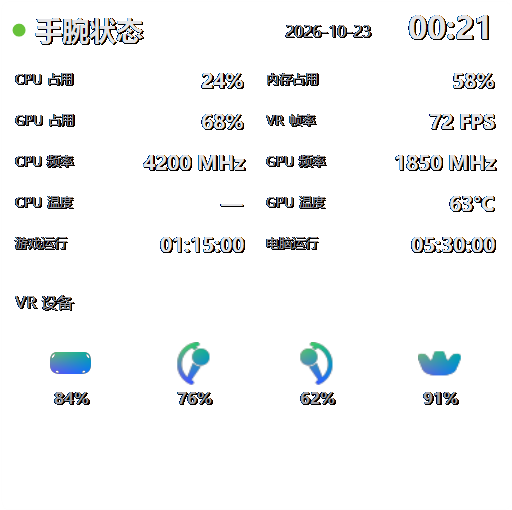

# VRWristLite：独立 SteamVR 手腕面板

这是一个独立运行的 Windows 程序。它借鉴 VRCX 的控制器按键检测和腕部摆放方式，在 SteamVR 中显示一个轻量的信息面板；无需启动 VRCX，也不登录 VRChat 账号。可以在第一版宽屏界面和使用 VRCX 素材的方形界面之间切换。

## 已实现

- 可选“按住显示、松开隐藏”或“按一次限时显示”。限时模式的时长可在设置窗口调整为 1–300 秒，默认 5 秒；持续按住不会延长显示时间，松开后再按一次会重新计时。
- 可选双手、左手或右手，以及握持键或菜单键。
- 可选“第一版（宽屏）”或“VRCX 素材（方形）”；首次使用默认第一版。
- 在同一行显示年月日和时间，日期位于时间左侧；显示 VR 设备的图标、电量、连接与追踪状态；CPU、内存和 GPU 占用率，CPU 与 GPU 频率、温度，VR 帧率，以及 VRChat 和电脑运行时长。各项可在设置中开关。
- 设备已连接但定位姿态无效时显示橙色“丢追”；断开时显示“离线”。如果 SteamVR 把设备从列表中移除，程序会在本次运行期间保留其离线图标。
- 参考 VRCX-0 的叠加层刷新顺序：将新画面上传到隐藏的叠加层，等待 SteamVR 的 `ImageLoaded` 事件后才显示新画面并隐藏旧画面；若收到 `ImageFailed` 则保留旧画面。这针对先前每秒刷新的闪动问题。程序会阻止同时运行多个 VRWristLite 或旧版 WristLite 实例。
- 保留上一版的简洁设置窗口与原生下拉框；独立设计的程序图标已嵌入程序。
- 可选 VRCX 深色背景、状态指示点以及各信息项的显示开关。
- 默认只在 VRChat 运行时显示；该限制可关闭。
- 关闭设置窗口时程序留在通知区域；右击通知区域图标可退出。

程序不读取好友或房间信息。

## 使用

1. 启动 SteamVR 和 VRChat。
2. 从仓库的 Releases 页面下载 Windows 压缩包，解压后运行 `VRWristLite.exe`。如果旧版 WristLite 正在运行，请先从通知区域退出。状态窗口应显示“SteamVR 已连接”。
3. 默认按住手柄握持键唤出面板。Oculus 控制器的 X/A 对应握持选项，Y/B 对应菜单选项，与 VRCX 的默认按键判断保持一致。
4. 在设置窗口的“触发方式”中选择“按一次限时显示”，设置“显示时长”（1–300 秒），点击“保存设置”后生效。再次按下按键会重新开始计时。
5. 在“界面样式”中切换第一版或 VRCX 素材版。保存后下次唤出即使用所选界面。

程序会在常见 SteamVR 安装位置寻找 `openvr_api.dll`。如果状态窗口提示找不到 DLL，可将 SteamVR 安装目录中的 `bin\win64\openvr_api.dll` 复制到可执行文件旁边，或将环境变量 `OPENVR_API_DLL` 设为该 DLL 的完整路径。不要从不明网站下载 DLL。

设置和手动生成的预览图片存放在 `%LOCALAPPDATA%\WristLite`，以便沿用旧版设置。运行时面板从内存更新。无需安装；退出后删除程序文件即可。需要清除设置时，可删除上述文件夹。

## 预览与构建

运行程序并添加 `--preview-classic`、`--preview-vrcx` 或 `--preview-settings` 参数，可分别生成两种面板或设置窗口的静态预览，无需 SteamVR。

在项目根目录运行 `./build.ps1` 构建 64 位 `VRWristLite.exe`，运行 `./test.ps1` 执行自动检查。两者使用 Windows 自带的 .NET Framework C# 编译器，不需要联网。`./package-release.ps1` 会构建、测试并生成包含程序和许可文本的发布压缩包。若编译器不可用，请安装 .NET Framework 开发工具。

## 运行条件与限制

- Windows 10/11、SteamVR/OpenVR、64 位 .NET Framework 4.8。
- 内存占用率是整机物理内存用量。CPU 频率是各逻辑处理器当前频率的平均值。GPU 占用率优先读取 NVIDIA 驱动，其他显卡尝试 Windows 3D 引擎计数器；GPU 频率和温度目前使用 NVIDIA NVML。CPU 温度可从正在运行的 Libre Hardware Monitor 的 WMI 传感器读取。设备或驱动不支持的数值显示“—”。
- VR 帧率来自 SteamVR 合成器的帧计时，不保证与 VRChat 调试菜单显示的帧率完全一致。
- VRChat 官方 OSC 未提供截图中“纹理缓存”数值的接口；程序不显示虚构或本地文件大小冒充的缓存值。
- 当前使用 OpenVR 的旧式控制器按键状态。若控制器只提供 OpenXR 输入或 SteamVR 按键映射未将按键暴露给旧式 API，唤出可能无效。
- 已完成编译、自动逻辑检查和静态画面检查。用户已在头显中实测此版本，目前未发现问题；后续设备及 SteamVR 版本可能存在兼容差异。
- 游戏运行时间来自本机 VRChat 进程启动时间；不会显示好友、房间或 VRChat 账号内容。

## 源码与许可

- [VRCX](https://github.com/vrcx-team/VRCX)：MIT。腕部摆放矩阵和旧式按钮位判断参考其 `VRCXVRCef.cs`；界面尺寸和颜色参考 `src/vr/vr.css`；设备图片来自 `src/public/images/vr/`。
- [OpenVR C# 绑定](https://github.com/vrcx-team/VRCX/blob/master/Dotnet/Overlay/OpenVR/openvr_api.cs)：由 Valve 生成，见 `LICENSE-OpenVR.txt`。
- [VRCX-0](https://github.com/Map1en/VRCX-0/blob/master/crates/host-desktop/src/vr_overlay/openvr_backend.rs)：研究其公开集成接口与收到 `ImageLoaded` 后再切换叠加层的顺序；本项目用独立代码实现该顺序，未复制其 GPL 源码。

项目自有代码采用 MIT 许可，见 [LICENSE](LICENSE)。VRCX 素材与 OpenVR 绑定保留各自的许可和署名，见 [第三方声明](THIRD_PARTY_NOTICES.md)。

